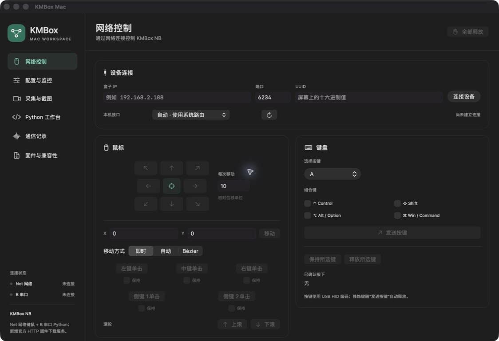
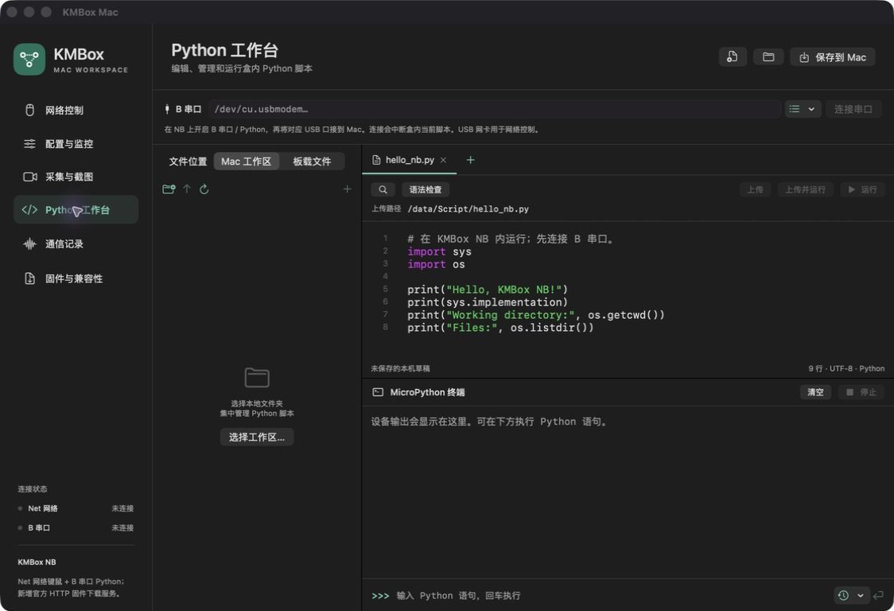
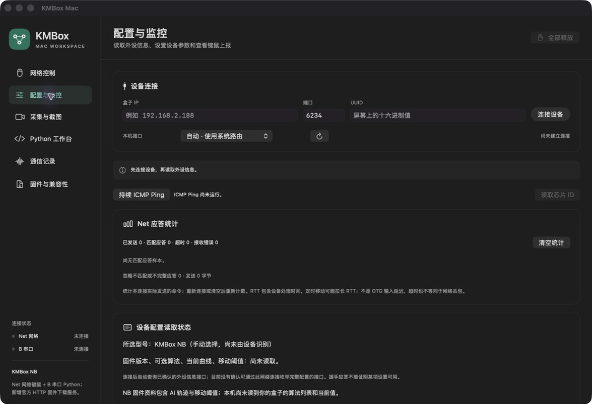
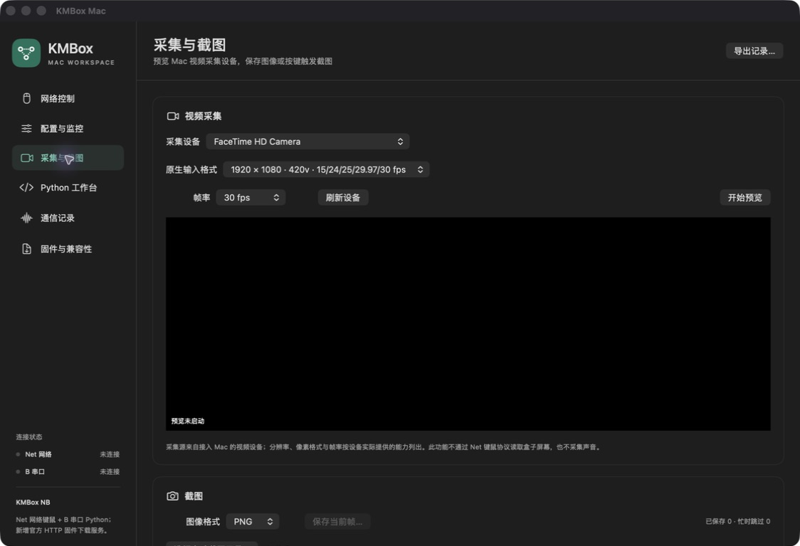

# KMBox Mac

> **Unofficial release**: independently developed, with no affiliation with or endorsement from KMBox, DFRobot, or MicroPython.

A native macOS workbench for KMBox network input control, device diagnostics, and MicroPython development. Includes a SwiftUI/AppKit app, the `kmctl` CLI, and a reusable `KMBoxCore` library.

[中文](README.md) · [Usage](docs/USAGE.md) · [Compatibility](docs/COMPATIBILITY.md) · [Protocol](docs/PROTOCOL.md) · [Sources](SOURCES.md)

Version **1.3.3**. The UI and detailed guides are currently in Chinese. This is an independent project, not an official KMBox, DFRobot, or MicroPython product. uPyCraft was a workflow reference; its Windows executable is not bundled.

## Actual app screenshots

These are actual windows from **1.3.1 (build 8) running on macOS**, with the bundled example script. No KMBox is connected and video preview is stopped. These show the 1.3.1 interface; 1.3.2 moves the trajectory panel to the top of diagnostics. Screenshots are not proof of hardware compatibility.

**Network control**: connection settings, relative/automatic/Bézier movement, mouse buttons and HID keyboard controls.



<details>
<summary>Show Python workbench, configuration/monitoring and video capture</summary>

**Python workbench**: local/board file access, syntax highlighting, upload/run controls and a MicroPython terminal. The bundled `hello_nb.py` has not been run on a device.



**Configuration and monitoring**: peripheral queries, ACK statistics and explicit unknown states for unread firmware, algorithms and thresholds.



**Video capture**: formats and frame rates enumerated from a real Mac video device. The built-in camera is listed; preview is stopped and the black area contains no video feed.



</details>

## Features and verification

The following features have desktop implementations. **Local verification covers code tests, loopback UDP, PTY test devices and GUI interactions. It is not hardware acceptance. An ACK does not prove OTG output or persistent configuration.**

| Capability | What it provides | Verified / still unverified |
| --- | --- | --- |
| Network input control | Relative movement, five mouse buttons, wheel, HID keys, combinations, hold/release | Local packet/state tests passed; **NB handshake and W/S/A/D output manually observed**; other actions lack complete hardware acceptance |
| Automatic / Bézier movement | Single commands with displacement, duration and control points | GUI and loopback packets checked; **actual motion and timing unverified**; does not configure NB AI algorithms |
| Device configuration | Peripheral queries, parsing-mode write/readback; legacy Net network, VID/PID, curve, mode and reboot commands | Local protocol/readback checks passed; NB once returned all-zero peripheral data; **effective settings, persistence and reboot unverified by model** |
| Reports and trajectories | Device reports, device/request plots and timestamped raw JSONL export | Local reception, plotting and export checked; **real NB mouse-motion reports received**; source separation, corrected-output sampling and third-party input coverage remain unverified |
| Diagnostics and vendor adaptation | Matching-ACK RTT/timeout statistics, ICMP, chip ID, vendor parsing suggestions and feedback | Local communication/failure paths checked; **real chip ID and vendor service unverified**; RTT is not OTG latency |
| Local Python editor | Tabs, highlighting, line numbers, indentation, search/replace, undo/redo, syntax checks, drafts and workspace | Local editing, file operations and main GUI flows checked; host Python syntax checks do not establish device-module support |
| B serial and board files | raw REPL, terminal, run/stop, transfer verification/backups and startup-script entry generation | PTY and file workflows checked; **real MicroPython, complete board workflows and startup behavior unverified** |
| Video and screenshots | AVFoundation preview/formats/frame rates, PNG/JPEG/BMP/TIFF and device-button-triggered capture | Enumeration/refresh, encoders and trigger logic checked; **complete capture-card-to-button-screenshot workflow unverified** |
| NB firmware hosting | CPIO checks, fingerprint and HTTP download for device-initiated updates | Local CPIO checks and complete HTTP transfer passed; **device download, flashing and reboot unverified** |
| CLI and library | `kmctl` and reusable native Swift `KMBoxCore`, shared with the GUI | 1.3.2 build passed **75 Swift tests and 83 CLI scenarios**; these are not hardware coverage counts |

See the [full feature mapping](docs/FEATURES.md) and [validation record](docs/VALIDATION.md).

**A USB network interface is not a Python REPL.** Network input control uses Net UDP. Board scripting and file management use the B serial interface with compatible firmware. The two connections are separate and can coexist.

## Download

Download `KMBox-Mac-VERSION-universal.zip` from [GitHub Releases](https://github.com/Ares-X/KMBox-Mac/releases/latest), extract it, and move `KMBox Mac.app` to Applications. The `kmctl` CLI is a separate attachment. Verify downloads against the accompanying `SHA256SUMS.txt`.

Requires macOS 13+. Both binaries support Apple Silicon and Intel. The app is ad-hoc signed, **not Developer ID signed or notarized**; macOS may block the first launch. Building from source is also supported.

## Build

Requires macOS 13+, an Xcode toolchain supporting Swift 5.9+, and Python 3's standard library for tests. There are no third-party Swift packages, Windows DLLs, Qt components, or Python GUI dependencies.

```bash
swift test
bash scripts/build-app.sh
open "dist/KMBox Mac.app"
./dist/kmctl --help
```

Both outputs are universal arm64/x86_64 binaries. The app is ad-hoc signed, not Developer ID signed or notarized. Build products are excluded from Git. Latest local checks used Apple Silicon/macOS 27.0.1/Swift 6.4; earlier releases were checked on macOS 26.6.2/Swift 6.3.3; minimum-OS and physical Intel-Mac acceptance remain unverified.

```bash
./dist/kmctl --host DEVICE_IP --port DEVICE_PORT --uuid DEVICE_UUID auto-move 100 0 500 --stats
./dist/kmctl --host DEVICE_IP --port DEVICE_PORT --uuid DEVICE_UUID monitor 10 6688 --monitor-output ./monitor.jsonl
./dist/kmctl --serial /dev/cu.DEVICE ls
```

Use actual device values and `--local MAC_IPV4` when selecting a specific interface. Startup does not automatically connect, run scripts, or flash a device. Serial connection interrupts the current board script to enter raw REPL.

## Not implemented

- **NB AI algorithm discovery/current settings/threshold readback**: confirmed network interfaces are missing. Legacy Net curve indices are not an NB algorithm catalog.
- **Three distinct human/program/corrected trajectory streams**: known reports do not identify the source. Current plots use the single received stream and this app's acknowledged request endpoints, without inferring source labels or inventing the other two streams.
- **Single-cable network Python, WebREPL and network board-file management**: scripting and files require B serial.
- **Input masking, LCD image commands and dedicated flashers for non-NB models**: not integrated. This app does not replace every kmNet SDK feature or every legacy uPyCraft board flasher.
- **Automatic model identification and complete firmware configuration discovery**: the selected model is manual; a successful handshake is not capability discovery.

## Model and platform acceptance

**NB handshake, some keyboard output and mouse-motion reports** have hardware observations. Net, NetPro 8K, NVideo, B+ / B Pro and AI entries follow public protocols/documentation and **have not completed model-specific hardware acceptance**. Model A is informational; its control protocol is not implemented. NB HTTP hosting does not flash other models. See [compatibility](docs/COMPATIBILITY.md).

Local macOS builds, signing and main-page interactions were checked; the Intel CLI starts under Rosetta. **Minimum-macOS and physical Intel-Mac acceptance remain unverified.** Firmware-page GUI automation was incomplete because the UI automation helper crashed, so that page's complete interaction flow is not recorded as passed.

Settings and drafts are local. Exported reports may contain input events. Optional vendor adaptation buttons contact the original host tool's plain-TCP service at `47.75.195.35:5002`; normal connection does not contact it. Camera access requires macOS permission. Vendor firmware, Windows tools, downloaded repositories and local logs are excluded from the public source tree.

## Contributing and license

See [CONTRIBUTING.md](CONTRIBUTING.md), [CHANGELOG.md](CHANGELOG.md), and [release instructions](docs/RELEASING.md). Original project code and documentation are licensed under [MIT](LICENSE). [SOURCES.md](SOURCES.md) records upstream references, pinned revisions and license observations; third-party material is not relicensed by this project.
