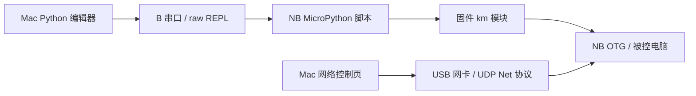

# 协议与实现依据

## uPyCraft 的控制路径

对照公开 uPyCraft 源码，编辑器通过串口 REPL 执行 Python、管理板载文件；键鼠能力由盒内固件模块提供。本项目使用原生界面和固定宽度协议结构重新实现工作流，不分发 uPyCraft 的 Windows 程序或 Qt 组件。

## Net UDP

- 头部 16 字节：`uuid:uint32`、`parameter:uint32`（历史命名 random）、`sequence:uint32`、`command:uint32`，全部小端。
- 鼠标消息体 56 字节：`buttons, x, y, wheel, point[10]`，均为 int32。普通移动总长 72 字节。
- 键盘消息体 12 字节：修饰键 1 字节、保留 1 字节、普通 HID 键码 10 字节。普通键超过 10 个时拒绝继续按下，不丢弃已按下的键。
- 初始化序号为 0；之后由 `NetClient` 独占递增。连接后的 UDP socket 限定应答源，接收端核对头长度、命令和序号；错序和短报文不构成成功。
- 查询超时不修改键鼠状态；配置超时报告执行未知，不触发键鼠恢复。超时不重发相对移动。可能已经执行的动作标记为不确定，直到显式全部释放；释放鼠标和键盘分别尝试，不能因鼠标应答失败而跳过键盘。
- 断开前会释放本客户端仍保持的按键。收到 ACK 只代表协议应答成立，不能据此报告已经观察到 OTG 输出。
- 五键完整状态使用 SDK 的 `mouse_all` 发送方式，即 wheel 命令配完整鼠标报告。滚轮正负方向沿用厂商文档（正数向下、负数向上）。

公开 SDK 的 `NetRxReturnHandle()` 会在末尾把错误值覆盖为 0。Mac 实现没有沿用这种错误处理，真实保留无应答、错序、设备异常等失败。

## raw REPL 与文件操作

连接先发送 Ctrl-C，再发送 Ctrl-A，等待 `raw REPL; CTRL-B to exit`。代码按 256 字节分块发送，Ctrl-D 提交；确认 `OK` 后按 stdout / EOT / stderr / EOT / `>` 解析。没有进行自动 soft reset。

解析器以字节工作，因此中文和 emoji 跨串口分块时不会在解码前损坏。输出轮询每次读取有上限，避免持续打印的脚本饿死停止操作。串口断开或帧错误会关闭会话并报告失败，不自动恢复后继续执行。

文件数据经过十六进制编码，与 Python 字符串和命令结构分离。路径使用 JSON 字符串转义，兼容 Python 字面量；上传使用临时文件、读回校验、原内容基线核对和备份改名。失败时保留现场，不把异常当成成功。

## 资料

- [DFRobot/uPyCraft_src](https://github.com/DFRobot/uPyCraft_src/tree/68dfc449ee1af7f4bdb0ba8a9a127ec890935d3b)，对照版本 `68dfc449…`。
- [KMBox Net C++ SDK](https://github.com/kvmaibox/kmboxnet/blob/9b62283c6271e8e594f3b97986fed291deb4318f/c%2B%2B_demo/NetConfig/kmboxNet.cpp) 与 [协议头](https://github.com/kvmaibox/kmboxnet/blob/9b62283c6271e8e594f3b97986fed291deb4318f/c%2B%2B_demo/NetConfig/kmboxNet.h)，对照版本 `9b62283c…`。
- [KMBox Net Python API 说明](https://www.kmbox.top/wiki_doc/kmboxNet/site/python/)。
- [MicroPython v1.13 pyboard 工具](https://github.com/micropython/micropython/blob/v1.13/tools/pyboard.py) 与 [内置函数](https://docs.micropython.org/en/v1.13/library/builtins.html)。
- [PEP 263](https://peps.python.org/pep-0263/)：旧 Python 源码转码时识别文件开头的编码声明并同步更新。
- [NB 官方接线说明](https://www.kmbox.top/wiki_doc/kmboxNB/site/01-connect/) 与 [NB 固件说明](https://www.kmbox.top/NB_firmware.html)。
- 完整引用关系、固定版本和许可观察见 [来源说明](../SOURCES.md)。

这些资料用于核对行为与报文；App 没有打包 Windows SDK、PyQt、原工具二进制或第三方运行库。厂商名称和协议名称保留各自归属；KMBox Mac 是独立实现。

## 2026-09-12：固件与其他型号

NB 的官方通用 Web 更新由设备下载 Mac HTTP 服务器的 `/kmboxNB.cpio`，默认 TCP 80。本版 `NBFirmware` 验证并固定原文件，`FirmwareServer` 负责有界请求处理、目标地址检查、可选来源限制和可中断传输；不会发送擦除命令或根据发送进度断言刷写成功。普通用户低端口监听采用 macOS `IP_BOUND_IF` 与目标地址复核，未使用提权助手。固定路径下载不提供 Python 网络 REPL。

`DeviceModel` 统一定义型号的 Net / 串口 / NB 固件服务能力。NetPro、NVideo、AI 仅按官方兼容声明开放通用 Net 控制，不包含设备专有扩展。A 为独立 HID 协议；B Pro 为串口及 ESP32 固件路径。下载的第三方 SDK、IAP 示例和固件只用于研究，未编译进原生产品。

型号、固件格式差异及未验证范围见 [兼容性矩阵](COMPATIBILITY.md)。

## 1.2.0 Net 配置扩展

同一 `NetClient` 拥有命令序号、参数编码、应答验证及监控生命周期。依据固定版本官方 SDK，并对照官网 Net 调试工具 20260904 与旧版 20251106 的静态行为；来源指纹见 [来源清单](sources.json)。Windows 文件不打包进产品或 Git。

| 功能 | 命令 | 参数槽及负载 |
| --- | --- | --- |
| 网络设置 | `0x1d3d3323` | 参数字节为 IPv4 四字节；负载为大端 UInt16 端口，总长 18 |
| VID/PID | `0xffed3232` | `VID \| PID << 16`，总长 16 |
| 曲线 | `0xbbcdddac` | 开启：`算法索引 << 24 \| 曲线值0..100`；关闭为 0。原 Net 工具索引为 Bezier=0、Arm=1、RT-Bezier=2、RT-Arm=3，不是 NB 设备返回的目录。官网页面列有 Auto，但两个 EXE 都没有其独立索引，不能凭文档顺序插入 Auto |
| 外设信息/解析 | `0xadce1238` | 读参数 0、写参数 1；10 字节负载，总长 26。读取负载全部初始化为 0 |
| KM/Bypass | `0x21223334` | KM=0、Bypass=1；重启单独调用 |
| 重启 | `0xaa8855aa` | 无负载；清理本连接输入/监控后发送一次，无 ACK 不能称已完成重启 |
| 监控 | `0x27388020` | 开启 `0xaa550000 \| 端口`，停止 0；接收绑定成功后才发送开启 |

外设返回前 8 字节为四项小端 UInt16：VID、PID、HID、Device ID；最后两字节为鼠标与键盘解析模式。读取要求至少 26 字节完整应答。写解析前读取当前标识，仅替换末两字节；写应答后再次读取，核对标识及模式。全零返回无法识别外设，不能据此推断 NB 固件完整支持该命令。

监控已知布局占前 20 字节：鼠标 reportID/buttons/Int16LE x/y/wheel 共 8 字节，键盘 reportID/modifiers/10 个 HID 键码共 12 字节。1.3.2 与上游取前缀的方式对齐：至少 20 字节才解码，额外字节完整保留但不解释，不足 20 字节计入未解析数。reportID 保留原值，不假定固定编号。来源 IPv4 必须为所连接的盒子，来源端口不作假设；错误来源仅计数，不保留其内容。每次最多读取 512 个报文，GUI 每约 33ms 拉取，并按批次更新轨迹。

轨迹按每条报告的相对位移累计。[官方 Net 手册](https://www.kmbox.top/wiki_doc/kmboxNet/site/)描述其可显示包含第三方软件输入的最终运动；上游主机实现为单路累计 XY。报文本身没有人工／程序／修正来源标签，也没有采样位置元数据，不能仅凭该布局确认每个 NB 固件的修正后输出或分离三路。NB 此次实测收到 20 字节鼠标位移报告，未测试第三方输入或阈值触发修正。

Net 配置 setter 的 ACK 语义有限，不宣称回读、持久化或实际应用已验证。`setParsing` 单独报告写入已应答但回读失败。监控开启 ACK 丢失仍记录待停止；停止关闭本地端口，即使停止 ACK 丢失，远端不确定状态仍允许在同一连接重试停止。断开失败保留错误，不报告远端已关闭。查询不会触发键鼠释放。

### NB 配置发现边界

连接后仅自动发送已确认的外设查询（参数 0），不会写入任何默认配置。该查询失败不关闭控制连接，全零标识不作为有效配置。型号目前由用户选择；没有已确认的固件版本、算法目录、当前曲线和移动阈值的网络读取接口。NB 20260903 固件包含 Box AI Trace / Moving Threshold 和本地配置文件，但这不足以推定可用的网络 API；不能将 Net 四项菜单套用为 NB 全部能力，不能猜 AI 编号。来源见 [NB 官方说明](https://www.kmbox.top/wiki_doc/kmboxNB/site/02-poweron/) 和 [来源文档](../SOURCES.md)。

## 1.3 定时移动、统计与监控日志

官方 `kmNet_mouse_move_auto` 使用 `0xaede7346`，`kmNet_mouse_move_beizer` 使用 `0xa238455a`。两者参数槽是请求毫秒数，负载均为 56 字节；Bézier 的 point[0...3] 为 x1/y1/x2/y2，其余六项零填充。每次从当前按键状态独立编码，不保留上一次控制点。普通移动的十项 point 全为零。实现见 `NetMovement.swift` 与 `NetClient.swift`；基准为固定官方提交 `9b62283c6271e8e594f3b97986fed291deb4318f` 的 C++ NetConfig 源码第 570/634 行。终点与控制点使用同一相对原点。

本程序接受 1–10000 ms，等待匹配应答的上限为请求时长加连接 timeout。等待有界，允许后续释放/断开完成；这是客户端范围，不宣称固件执行时长上限或 ACK 到达等于轨迹执行完毕。没有已确认的单次运动中途取消命令，不声称关闭窗口或释放按键能撤销盒内已接收的运动。

`NetClient` 独占事务统计：send 成功才增加 sent/bytesSent；收到匹配且足够长的应答才增加 acknowledged 和 RTT；超时与其他接收错误分别计数。无效本地输入、发送前失败及不确定状态下被阻止的命令不算已发送。RTT 方差使用全部成功样本的总体方差在线计算，内存 O(1)；新连接重置，断开后保留统计，清空不发报文。统计混合握手、查询、配置与输入，包含设备处理时间；不是单向延迟或真实网络丢包测量。

JSONL 第一行 `kind=capture`、`schemaVersion=1`；GUI `mode=retained-snapshot` 带 retainedRecords/discardedRecords，CLI 为 live-stream。后续 `kind=datagram` 带 sessionID、Mac 赋予的接收 sequence、receivedAtUnixSeconds（秒）、monotonicNanoseconds（开机单调时钟纳秒）、sourceIPv4/sourcePort/listenPort、rawLength（1.3.2 新增）、rawHex、可选 frame/decodeError。序号不是固件包序号；时间戳在 recvfrom 返回后取得，不是设备或内核时间。未解析数据和附加字节不虚构来源类别或曲线数据，空闲不合成零值。CLI SIGINT/SIGTERM 后保留部分日志并停止监控；UDP 或系统缓冲区丢包无法由接收序号推算。

1.3.2 的监控汇总新增 `received`（目标设备报文）、`undecodable`（不足 20 字节）、`foreignSource`（非目标来源）、`extended`（已解析但多于 20 字节）及 `lastReceivedLength`。保留原 `accepted` / `rejected` 字段；`received = accepted + undecodable`，`rejected = undecodable + foreignSource`。空闲不更新计数或最近收包时间。
